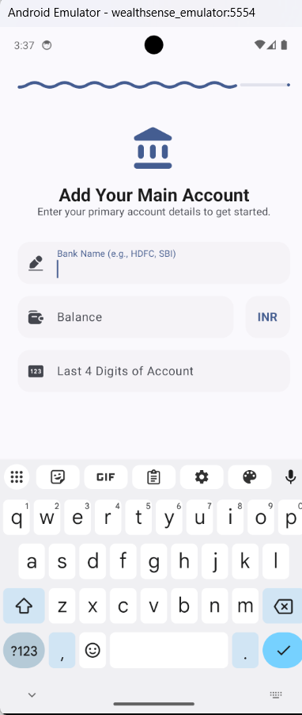
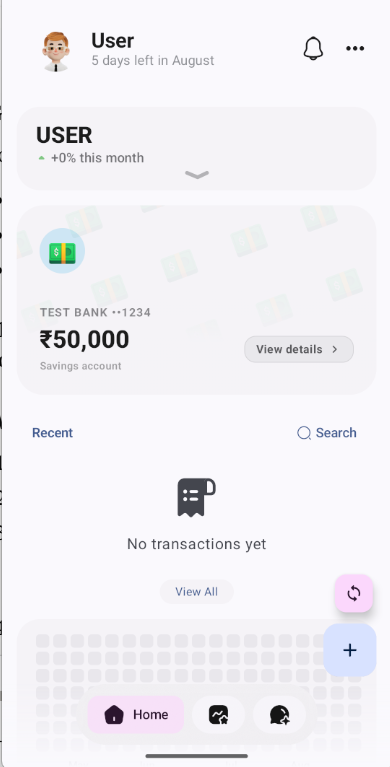
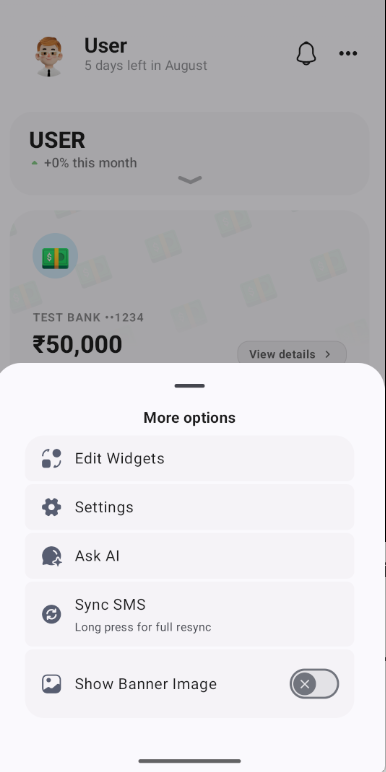
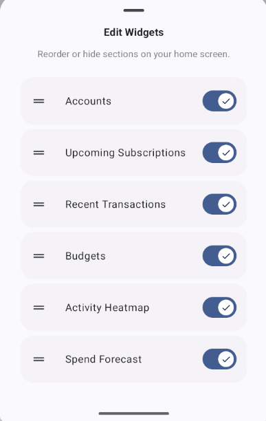
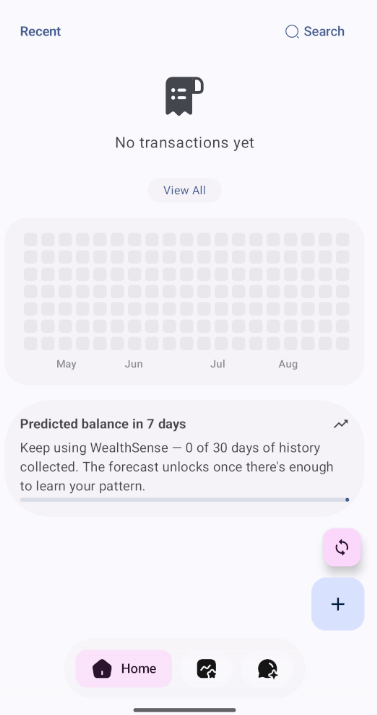

# WealthSense

On-device personal finance tracking that reads your transaction SMS, predicts
your balance a week out, catches spending that looks wrong, and anchors a
tamper-evident record of it all on-chain — without ever sending your
financial data anywhere it doesn't need to go.

Two trained ML models run entirely on your phone. Blockchain anchoring is
the one part that talks to a network, and even that's fire-and-forget so a
bad connection never blocks the app.

---

## Screenshots

These are **real screenshots from the actual app running on an Android
emulator**, taken during development — not mockups. A couple of newer
features (login screen, the "Send Test SMS" button, the on-chain badge)
were built after these were taken and don't have screenshots yet; that's
noted below rather than faked.

<table>
<tr>
<td width="33%">

**Onboarding**



First-run flow: add your primary account to get started.

</td>
<td width="33%">

**Home Screen**



Balance, recent transactions, and the bottom nav (Home / Insights / Chat).

</td>
<td width="33%">

**More Options**



Edit Widgets, Settings, Ask AI, Sync SMS. *(Taken before the "Send Test
SMS" and "Link Bank Account" items were added to this same sheet —
they'll appear here too on a fresh build.)*

</td>
</tr>
<tr>
<td width="33%">

**Edit Widgets**



Reorderable home screen sections, including "Spend Forecast."

</td>
<td width="33%">

**Forecast Card — Cold Start**



The on-device LSTM correctly detecting insufficient history (0/30 days)
on a brand-new account, instead of guessing or crashing.

</td>
<td width="33%">

**Not yet screenshotted**

Login/Signup screen, "Send Test SMS" in action, the anomaly-alert
notification, and the green "On-chain" badge — all built and wired, but
after this session's last real device run. See [SETUP.md](SETUP.md) to
generate these yourself in a few minutes.

</td>
</tr>
</table>

---

## What's actually in here

| Component | What it does | Status |
|---|---|---|
| **Android app** | Open-source base, rebranded and extended | Builds and runs — verified on a real Windows machine + emulator |
| **Bidirectional LSTM** | Predicts balance 7 days ahead from 30 days of history | Trained, evaluated (MAE ₹2,879), exported to TFLite, integrated |
| **Isolation Forest** | Flags anomalous spending in real time | Trained, evaluated (F1 0.694), exported to ONNX, integrated |
| **Smart contract** | Anchors a transaction hash per user, on Polygon Amoy | Compiled, 3/3 unit tests passing against a real local blockchain |
| **FastAPI bridge** | Signs and submits anchoring transactions on the app's behalf | Verified end-to-end against a real deployed contract |
| **Simulated login/signup** | Local-only auth, real per-user data isolation | Built this session — see below, not yet run on a device |

---

## Simulated login & per-user data

This is **not** real bank account linking (see the "Link Bank Account —
Coming soon" item in the app itself, which is intentionally a different,
not-yet-built feature). It's a local, on-device username/password system
that gives each signed-up user their **own physically separate database
file** on the same phone — not just a filtered view over shared rows.

- Credentials live in a small, separate Room database
  (`data/auth/AuthDatabase.kt`), passwords stored as salted SHA-256 hashes,
  never plaintext.
- On successful login/signup, the app records which user is active and
  **restarts its own process**. This is deliberate, not a workaround: the
  main financial database (the Room database class) is a Hilt singleton built
  once per process, and its filename is chosen from the active
  username at construction time
  (`di/DatabaseModule.kt`). A clean restart is the
  standard, honest way to force that singleton to rebuild against the
  newly logged-in user — the same pattern many real apps use for account
  switching.
- Every DAO, ViewModel, and service that already existed in this codebase
  (transactions, forecasts, anomaly detection, on-chain anchoring)
  continues to work completely unchanged — they still just ask Hilt for
  "the" database. They now transparently get a different physical file per
  user, with zero changes to their own code.

---

## Quick start

Full details, every command, and troubleshooting notes are in
**[SETUP.md](SETUP.md)**. Condensed version:

```bash
# 1. Get the code (use the .bundle for full git history)
git clone wealthsense-history.bundle wealthsense
cd wealthsense/android-app

# 2. Build
./gradlew.bat assembleDebug        # Windows
./gradlew assembleDebug            # macOS/Linux

# 3. Install & run (with an emulator or device connected)
./gradlew.bat installStandardDebug
adb shell monkey -p com.wealthsense.app -c android.intent.category.LAUNCHER 1
```

Once it's open: sign up with any username/password (simulated, local
only), add a test account, then use **`•••` → "Send Test SMS"** to
generate a realistic fake bank SMS and watch the full pipeline run —
parsing, categorization, anomaly scoring, and (if a backend is running,
see SETUP.md §6) on-chain anchoring.

---

## Project structure

```
wealthsense/
├── android-app/    WealthSense app (Kotlin, Compose, Room, Hilt)
├── ml-training/     Forecaster + anomaly detector: data, training, evaluation, export
├── blockchain/       TransactionLedger.sol (Hardhat, Polygon Amoy)
├── backend/           FastAPI bridge (Web3.py) between the app and the chain
└── docs/                Setup guides, evaluation artifacts, screenshots
```

---

## Credits and licence

WealthSense is distributed under **GPL-3.0** and builds on an open-source
SMS expense-tracker base; the required attribution and the original licence
are in [`NOTICE.md`](./NOTICE.md) and [`android-app/LICENSE`](./android-app/LICENSE).
The git history preserves the exact boundary between the imported base and
every change made afterwards.

**Built new for this project:** the Bidirectional LSTM forecaster and
Isolation Forest anomaly detector (all of `ml-training/`), the blockchain
layer (`blockchain/`, `backend/`, WorkManager integration), the simulated
login and per-user database, demo mode, and this monorepo's structure.
